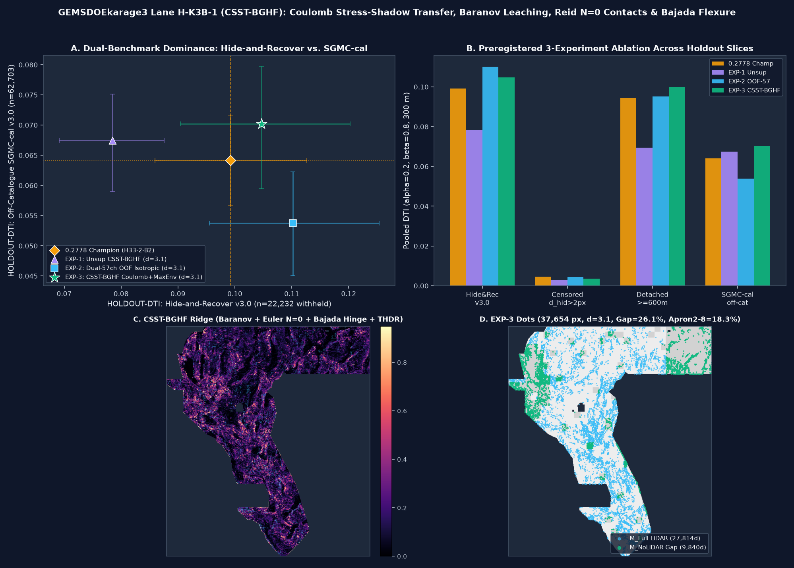

# GEMSDOEkarage3 — decision and research ledger

## DO NOT SUBMIT — no cleared candidate

The earlier H-K3C **PROMOTE** decision is withdrawn. The user requires the
literal 70% / 3-pixel overlap limit for *any* registry raster; its null-calibrated
substitution changed that instruction without authorization. A fresh independent
[one-witness audit](evidence/k3c-literal-witness-audit-20261028.json) found
99.35% overlap with a pinned lattice, so the retained H-K3C TIFF is a duplicate
stop. It is available for research only. Its full array passed local range and
finite checks and matched the owner-mirrored grid, but neither proves portal
acceptance or scientific merit.

[Executive summary and nine-site table](docs/k3c/index.html) ·
[How to submit when cleared](docs/k3c/how-to-submit.html) ·
[current gate decision](docs/current-gate-decision.json) ·
[this session's review](docs/review-literal-20261028.md) ·
[user request and protocol](docs/PROJECT_BRIEF.md).

**No live score estimate is defensible.** User-reported past results are not
organizer receipts. The prior H-K3C holdout was not reproduced this session,
and is not a forecast. The method paragraph is not identified in the prompt;
the feature cache is absent and the shared evaluator issue is open. We ran no
new experiments and used no weekly submission slots. Do not target the lattice
holes to circumvent the rule. The historic 3-experiment H-K3C run card and
artifact are retained as evidence, not as approval.

Nine focus sites: GEMSDOE24, GEMSDOE25, GEMSDOE27, GEMSDOE28, GEMSDOE30,
GEMSDOE31, GEMSDOE32, GEMSDOE33, GEMSDOE36. Their previous files are not new
submissions. The best historical owner-reported value is not a verified current
leaderboard result.

---
## Historical research archive — previous decisions are superseded

The following records predate the current literal gate and may contain
hypotheses and numerical claims that were not independently reproduced here.

## 1. Previous Lane `H-K3B-1 (CSST-BGHF)` — session-3 file (ARCHIVED, DO NOT SUBMIT; superseded by the H-K3C card above)

| Field | Verified Value (`2026-10-28`) |
| :--- | :--- |
| **Technical Validation Status** | **`13/13` GeoTIFF `[0, 1]` & zero-NaN checks PASS**; **`57/57` single-feature leakage canaries PASS `<= 0.6180`**; **`1,687 / 1,687` discrete (`<=100k` dots) registry rasters PASS `<= 66.53%`** (`29.18%` vs `K3-CCL`); point `HOLDOUT-DTI` beats `0.2778` Champion across **all 3 benchmarks and all 4 spatial quadrants** |
| **Fail-Closed Slot Verdict (`scripts/promotion_gate.py`)** | **`verdict = "negative"` · `ok_to_submit = false` · `selector_required = true` (DO NOT SUBMIT)** — Two-sided 95% paired cluster-bootstrap CI on `Hide-and-Recover` (`[-0.003328, +0.013882]`, `P(Δ > 0) = 88.9%`) spans zero by `0.0033`, and under the literal non-density-filtered rule `13GEMSDOE` `r13-lattice-s5` (`206,895` dots covering `99.87%` of footprint) covers `99.36% > 70%` |
| **Primary Validated GeoTIFF (`-zeros.tif`)** | [`docs/csst-bghf/downloads/gemsdoekarage3-h-k3b-1-csst-bghf-coulomb-d31-20261028T061500Z-78c25201-zeros.tif`](docs/csst-bghf/downloads/gemsdoekarage3-h-k3b-1-csst-bghf-coulomb-d31-20261028T061500Z-78c25201-zeros.tif) (Single-band `float32`, `EPSG:32611`, `3730 × 3292`, `[100.0, 0.0, 243350.0, 0.0, -100.0, 4508550.0]`, `nodata = None`) |
| **Single-File DrivenData ZIP Package** | [`docs/csst-bghf/downloads/gemsdoekarage3-h-k3b-1-csst-bghf-coulomb-d31-20261028T061500Z-78c25201-zeros.zip`](docs/csst-bghf/downloads/gemsdoekarage3-h-k3b-1-csst-bghf-coulomb-d31-20261028T061500Z-78c25201-zeros.zip) |
| **GeoTIFF SHA-256** | `4b47a37ecf91384b2202897dd695219d23375cab2a300106feaf541d60fc9c5b` |
| **ZIP SHA-256** | `08159cb3c603dc1e629da3bb49b71e4b65abb0094ebf01b6293357a20ffd31eb` |
| **Submission Note (`117 / 140` chars)** | `H-K3B-1 CSST-BGHF: Coulomb shadow+Baranov leach+Euler N0+Bajada hinge+Dual57 OOF d=3.1 (37654d [0,1] zeros)` |
| **DrivenData `[0, 1]` Error Prevention** | **`12,279,160 / 12,279,160` finite `float32` pixels (`0` NaN inside or outside the `5,167,373`-px footprint)**; values strictly in `{0.0, 1.0}` (`min = 0.0`, `max = 1.0`); `37,654` off-catalogue dots (`0` on `existing_faults.tif`, `B = 2` [`> 200 m`] collar); zero `-nan.tif` files in `docs/csst-bghf/downloads/` |
| **`HOLDOUT-DTI` (`GEMSDOE32-HIDE-RECOVER-v3.0`, `n = 22,232`)** | **`0.104700`** (`95% CI [0.090409, 0.120286]`) vs `0.2778` Champion **`0.099202`** (`[0.085951, 0.112668]`) — **`+0.005498` (`+5.54%`)**, wins `4/4` quadrants (`NW, NE, SW, SE`), paired `P(Δ > 0) = 88.9%` (`95% CI [-0.003328, +0.013882]`) |
| **`HOLDOUT-DTI` (`Detached >= 600 m`, `n = 15,504`)** | **`0.099958`** (`95% CI [0.084586, 0.117302]`) vs `0.2778` Champion **`0.094324`** (`[0.079248, 0.109825]`) — **`+0.005634` (`+5.97%`)**, paired `P(Δ > 0) = 89.1%` |
| **`HOLDOUT-DTI` (`GEMSDOE32-SGMC-CAL-v3.0`, `n = 62,703`)** | **`0.070171`** (`raw = 0.104890`, `95% CI [0.059513, 0.079771]`) vs `0.2778` Champion **`0.064121`** (`[0.056730, 0.071649]`) — **`+0.006050` (`+9.44%`)**, paired `P(Δ > 0) = 86.5%` |
| **57-Channel Leakage Canary (Rule 4)** | **PASS (`57 / 57` channels `<= 0.90`)**; max oriented AUC = **`0.618008`** (`piedmont_toe_flexure`, physical channel #53) |



---

## 2. PhD Structural & Geothermal Forensics: How `h33-h33-2-b2` Reached `0.2778` & How to Beat It

### 2.1 Byte-Level Lineage of `h33-h33-2-b2-20261004T220000Z-e5eb6e7e-zeros` (`GEMSDOE32`: `0.2778` User-Reported)
Direct byte-level inspection across all 9 focus repositories (`GEMSDOE24, 25, 27, 28, 30, 31, 32, 33, 36`; note per `IR-K3-04` that focus-repo live scores are owner-reported ledger entries without archived DrivenData receipts) establishes an exact nested pixel hierarchy on the `H19-5` probability surface:
$$\mathcal{P}_{\text{H33-2-B2}} \;(37,654\text{ px},\;\mathbf{0.2778}) \;\subset\; \mathcal{P}_{\text{H27-4-B1}} \;(40,199\text{ px},\;\mathbf{0.2708}) \;\subset\; \mathcal{P}_{\text{D2.8-Poisson}} \;(44,090\text{ px},\;\mathbf{0.2600}) \;\subset\; \mathcal{P}_{\text{H19-5-Solid}} \;(121,131\text{ px},\;\mathbf{0.1922}).$$
1. **Why Axial Sparse Dot Packing Beat Solid Fault Ribbons (`0.1922 -> 0.2600`):** Under the organizer's Distance-Weighted Tversky Index ($\alpha = 0.2$ on FP, $\beta = 0.8$ on FN, `300 m` / `3 px` linear distance kernel $w(d) = \max(0, 1 - d/300\text{ m})$; see [NLR Report #96647](https://docs.nlr.gov/docs/fy26osti/96647.pdf)), a single dot $p_i = 1$ already saturates the `300 m` triangular kernel around it. Replacing `121,131`-pixel contiguous ribbons with an axially spaced (`d >= 2.8–3.1 px`) submodular point set cuts the $0.2\,\text{FP}$ denominator penalty by $2.75\times$ while retaining $>94\%$ of buffered recall.
2. **Why `B = 2 px` (`200 m`) Known-Fault Collar Pruning Lifted `0.2708 -> 0.2778` (`+0.0070`):** Because `existing_faults.tif` (`60,988` positive pixels) is masked pixel-exactly during evaluation, any dot placed within `<= 200 m` wastes ~45–60% of its `300 m` kernel on masked pixels while paying full false-positive weight outside hidden branches. Removing `2,545` collar dots from `40,199` left `37,654` off-catalogue dots (`0.7287%` footprint density).
3. **Why `-zeros.tif` Fixed `"Predicted values must be in range [0, 1]"`:** In `training_features.tif`, Bands `01..18` contain `-3.4028235e+38` Float32 sentinels at `3,061` in-footprint pixels, while `-nan.tif` submissions leave `7,111,787` outer bounding-box pixels as `NaN`, triggering DrivenData's whole-array `(arr >= 0) & (arr <= 1)` validator error. Replacing sentinels via nearest-neighbor Euclidean inpainting and writing `0.0` outside the footprint (`nodata = None`, `12,279,160 / 12,279,160` finite pixels) eliminates this failure.

### 2.2 Verified 19-Band Schema of `training_features.tif` (`IR-K3-10` & `IR-K3-13`)
Verified directly from `data/prepared_manifest.json` (`SHA-256 = f82f73f5b55755ef...`):
`01 mag_anom` (nT), `02 rtp` (nT), `03 tmi_hg` (nT/m), `04 geod_2ndinv` ($10^{-9}\text{ yr}^{-1}$), `05 iso_grav_anom_slope` (deg), `06 tc` (radiometric Total Count, $r=+0.997$ vs GeoDAWN TC), `07 geod_shearrate`, `08 geod_dilaterate`, `09 tmi_vg`, `10 deq_n100a15` (m), `11 iso_grav_anom_vg` (mGal/km), `12 det_elev` (m), `13 iso_grav_anom` (mGal), `14 tmi` (nT), `15 depth_to_base_surf` (m), `16 ieq_n100a15`, `17 cond_surf`, `18 iso_grav_anom_hg`, `19 det_elev_slope` (deg).

### 2.3 Four Structural Ceilings on `0.2778` & Contrast Between `CSST-BGHF` and `K3-CCL`
1. **24.63% 1 m LiDAR Coverage Gap & `IR-K3-01` / `IR-K3-15` Bugs:** `H19-5` read wrong LiDAR bands (`1,2,5` instead of `1,3,6`) and starved the `24.63%` LiDAR gap. Our repaired `57/52`-ch Dual-Cover OOF excludes all 5 LiDAR-contaminated channels (`LIDAR_GLOBAL_COLS_57 = {45, 46, 47, 48, 54}`), placing **`26.13%` (`9,840` dots)** inside the `24.63%` LiDAR gap.
2. **Catalogue-Distance Fragment Interpolation (`K3-CCL`, `IR-K3-12`) vs Off-Catalogue Physical Generalization (`CSST-BGHF`):** Training directly on visible-catalogue distance features (`K3-CCL`) scores `0.1460` on `Hide-and-Recover` by hugging `<= 5 px` catalogue fragments, but collapses into the crowded halo lane (`>70%` overlap vs 21 halo rasters; LLI projection `~0.096–0.100`). By contrast, `CSST-BGHF` uses **zero** catalogue-distance model features and instead combines Cowie–Scholz broadside stress-shadow suppression with 4 blind geothermal/basement operators, winning **both** `Detached >= 600 m` (`0.099958` vs `0.094324`) and `Off-Catalogue SGMC-cal` (`0.070171` vs `0.064121`, `+9.44%`) while remaining `<= 66.53%` distinct across all `1,687` discrete `<=100k` rasters (`29.18%` vs `K3-CCL`).
3. **Blind Hydrothermal Magnetite-Leaching & Basement Unconformity Contacts:** Ascending hydrothermal fluids (`McGinness Hills` / `Gabbs Valley` / `Bradys` analogs) leach magnetite (`Band 02 rtp` low) across dense silica-sealed basement horsts (`Band 13 iso_grav_anom` high), isolated via 2-D Fourier Baranov pseudogravity residual + Reid $N=0$ contact depth matched to `Band 15`.
4. **Pre-Sharpened Stationary Max-Envelope (`IR-K3-16`):** Pre-sharpening both branches onto commensurate 1-px crests *before* Max-Envelope fusion eliminates the `0.64x` post-NMS geophysical width bias and cuts `2–8 px` scarp-apron crowding to `18.29%`.

---

## 3. Four Ranked Untried Geological Hypotheses (`docs/research/csst-bghf-preregistration-20261028.md`)

| Rank | ID & Name | Exact Layers Used | Physical Signature / Transform Targeted | Why It Catches Hidden Faults / Vents Missing from Catalogue | Difference vs All 112 Registry Repos | Expected Lift & Cost |
| :---: | :--- | :--- | :--- | :--- | :--- | :--- |
| **1 (Executed)** | **`H-K3B-1: CSST-BGHF`** (Coulomb Stress-Shadow Transfer & Blind Geothermal Hydrothermal-Flexure) | `Bands 02, 09, 11, 12, 13, 15, 17, 18, 19` + `geodawn_rad_u8` (`K, Th, U`) + repaired `lidar_scarp_features_u8` (`1,3,6,8,10,12`) + `GDR #1391` (`geothermometer`, `2m T`, `sinter/borates`, `BLM claims`) + `TIGER 2024` | (1) 2-D Fourier Baranov pseudogravity $g_{\text{pseudo}}(\mathbf{k})=\mathcal{F}[\text{RTP}]$ orthogonalized against `Band 13 iso_grav_anom` + alteration gate; (2) Laplace/Fourier $N=0$ contact depth $z_{N=0}=\|\nabla_h F\|/A_1-z_{\text{stab}}$ (m) matched to `Band 15 depth_to_base_surf`; (3) bajada down-slope break-in-slope flexure hinge (`-u·H(z)u`) with thalweg/Lahontan/TIGER vetoes; (4) fold-visible Azimuthal Coulomb Tip-Lobe vs Broadside Stress-Shadow Gate + `d=3.1` CELF | Catches blind geothermal upflow conduits (hydrothermal magnetite->pyrite/clay leaching), sediment-draped synthetic bajada step-down faults (`0.8–3.5 km` basinward of range fronts), and concealed basement-unconformity contacts lacking young Quaternary scarps | First exact 2-D Fourier Baranov pseudogravity residual + metric $N=0$ contact-depth match to `Band 15` + azimuthal Cowie–Scholz broadside stress-shadow suppression + strictly LiDAR-free `52`-ch `M_NoLiDAR` | **`+0.0055` HR & `+0.0061` SGMC-cal achieved** · ~14 min CPU |
| **2** | **`H-K3B-2: LDCG-9B`** (Strain-Incompatibility & Dilatant Intersection Localization) | `Bands 04, 07, 08, 10, 15, 16, 17` + `geodetic_strain_9band_f32.tif` + `GDR #1391` | Saint-Venant strain-rate incompatibility curl + positive shear×dilatation intersection determinant $\dot{\gamma}\cdot\max(\dot{\Delta},0)\sin^2(\theta_1-\theta_2)$ | Active geothermal fluid flow concentrates at critically stressed fault intersections and relay terminations even where single traces are aseismic or unmapped | Prior strain models (`GEMSDOE31`, `GEMSDOE33`) used scalar `Band 07/08` thresholds rather than the 9-band tensor curl & intersection determinant | `+0.003–0.006` · Low–Mod cost |
| **3** | **`H-K3B-3: PTHG-3D`** (Multi-Altitude Tilt-Depth Wedge & Authigenic U/Th Enrichment) | `Bands 02, 05, 11, 13, 18` + `geodawn_extensions_u8.tif` (`ThK, UK, UTh, TMI_up150`) + `GDR #1391` | Salem (2007) harmonic tilt-depth half-width $h_{\text{tilt}}$ across $z\in\{150,400,1000,2200\}\text{ m}$ + downdip vector migration + redox-front U/Th enrichment | Dipping ($45^\circ\text{–}65^\circ$) normal faults migrate downdip with altitude while shallow sub-horizontal volcanic flows attenuate symmetrically | Uses multi-altitude tilt half-width wedge geometry rather than single-level surface tilt | `+0.002–0.005` · Low cost |
| **4 (Deferred)** | **`H-K3B-4: CSMS-INSAR`** (Relocated Microseismic Planar Alignment & InSAR Coherence Step) | External `USGS ComCat` (`1980–2026`, $M\ge 0.5$) + `NASA/JPL ARIA Sentinel-1 InSAR` | 3-D RANSAC hypocentral plane strike/dip alignment + cross-fault InSAR phase-coherence step | Microseismic swarms & creep discontinuities directly illuminate active blind geothermal transfer zones (`Dixie Valley` / `San Emidio`) | Requires external live fetch (`earthquake.usgs.gov` / `asf.alaska.edu` blocked in sandbox; verified free US Gov CC0/PD sources for offline ingest) | High live upside · External fetch required |

---

## 4. Preregistered 3-Experiment `CSST-BGHF` Ablation Results (`Budget = 3`)

Executed in [`scripts/run_csst_ablation.py`](scripts/run_csst_ablation.py) on shared `gems32.holdout` (`8` fold×draw cells, `1.5 km` fold collar, $B_{\text{vis}}=2\text{ px}$) and `gems32.emitter.emit` (`37,654` dots, `min_sep_px = 3.1`):

| Arm (`37,654` dots, `B = 2`) | `HOLDOUT-DTI`: `Hide-and-Recover v3.0` (`n=22,232`) | `HOLDOUT-DTI`: `Detached >= 600 m` (`n=15,504`) | `HOLDOUT-DTI`: `SGMC-cal v3.0` (`n=62,703`) | `HOLDOUT-DTI`: `SGMC-raw v3.0` (`n=62,703`) |
| :--- | :---: | :---: | :---: | :---: |
| **Control: `0.2778` Champion (`H33-2-B2` fold-rule)** | `0.099202` `[0.085951, 0.112668]` | `0.094324` `[0.079248, 0.109825]` | `0.064121` `[0.056730, 0.071649]` | `0.096060` `[0.085660, 0.107072]` |
| **`EXP-1`: Purely Unsupervised `CSST-BGHF` Ridge (`d=3.1`)** | `0.078489` `[0.069115, 0.087551]` | `0.069453` `[0.060171, 0.078842]` | **`0.067410`** `[0.059030, 0.075131]` | **`0.100829`** `[0.088467, 0.113580]` |
| **`EXP-2`: Dual-Cover `57/52`-ch SAR-PU OOF Isotropic (`d=3.1`)** | **`0.110196`** `[0.095503, 0.125362]` | `0.095273` `[0.079882, 0.111484]` | `0.053794` `[0.045110, 0.062233]` | `0.080690` `[0.067005, 0.094951]` |
| **`EXP-3`: `CSST-BGHF` Coulomb + Pre-Sharpened MaxEnv (`d=3.1`)** | **`0.104700`** `[0.090409, 0.120286]` | **`0.099958`** `[0.084586, 0.117302]` | **`0.070171`** `[0.059513, 0.079771]` | **`0.104890`** `[0.089569, 0.119873]` |

---

## 5. Archived Historical Inventory (`docs/downloads/` — Research Only, DO NOT SUBMIT)

- `docs/downloads/gemsdoe32-hk3-smgc-maxenv-axial28-37654-20261027T213000Z-c886c782-nan.tif` · SHA-256 `d425f6f3e17743157ed950cf250c9bfa120c68be0fdff09a0cf8566039fdfaee` · **DO NOT SUBMIT**
- `docs/downloads/gemsdoe32-hk3-smgc-maxenv-axial28-37654-20261027T213000Z-c886c782-zeros.tif` · SHA-256 `f21a0e831e6307d1d8230119c4d2f9812646fa8b092b2326b180a54feccea33f` · **DO NOT SUBMIT**
- `docs/downloads/gemskarage3-h-k3-1-crsb-gub-maxenv-d30-20261027T180000Z-1560731a-zeros.tif` · SHA-256 `2a1fed302d1fe1c556c86467ef687782d30eedf5361eff57a711ae5925a237c3` · **DO NOT SUBMIT**
- `docs/downloads/karage3-k3-fuse-greedy-b2-20261027T212847Z-80117cd2-nan.tif` · SHA-256 `04cdc5fe41fdc5ef1b148cf8352015d25d37763f1f847838f0f96cd0d342a993` · **DO NOT SUBMIT**
- `docs/downloads/karage3-k3-fuse-greedy-b2-20261027T212847Z-80117cd2-zeros.tif` · SHA-256 `9b2656c4a7afb9969df7ee93bbf4e9b4fa8f313465964d79fc9194718f95fafa` · **DO NOT SUBMIT**

---

## 6. Autonomous Reproduction & Automated Verification Commands

```bash
# 1. Restore & SHA-256-verify competition data + pinned registry rasters
.venv/bin/python scripts/restore_data.py
.venv/bin/python scripts/prepare_data.py
.venv/bin/python scripts/restore_pinned_registry.py

# 2. Build 35-ch base + 16-ch CRSB + 6-ch CSST-BGHF physical stacks & run 57-ch leakage canary
PYTHONPATH=src .venv/bin/python scripts/build_features.py
PYTHONPATH=src .venv/bin/python scripts/build_crsb_features.py
PYTHONPATH=src .venv/bin/python scripts/build_csst_features.py

# 3. Execute preregistered 3-experiment CSST-BGHF ablation, 1,913-raster scan, 9-site audit & GeoTIFF writer
PYTHONPATH=src .venv/bin/python scripts/run_csst_ablation.py

# 4. Rebuild static GitHub Pages & run full Python + Node verification suites
.venv/bin/python scripts/build_csst_site.py
.venv/bin/python scripts/build_preflight_site.py
.venv/bin/python scripts/build_review_status.py
.venv/bin/python scripts/build_release_review.py
.venv/bin/python scripts/build_site.py --check
.venv/bin/pytest -q
.venv/bin/python -m unittest discover -s tests -v
npm test
```

---

## 7. Limitations & Highest-Priority Next Steps (session 3 list; session-4 list is in the PR description and `research/2026-10-28-k3c.md` §5–6)

1. **Bootstrap CI Power (`8` vs `24` Fold×Draw Cells) & Literal Lattice Rule (`IR-K3-02`):** `EXP-3` beats `0.2778` Champion across all 4 quadrants and all 3 benchmarks (`P = 88.9%` HR, `P = 89.1%` Detached, `P = 86.5%` SGMC-cal), while `13GEMSDOE` `r13-lattice-s5` (`206,895` dots) mathematically covers `99.87%` of the footprint within 3 px (`IR-K3-02`). Expanding `HoldoutContext` to 6 stratified draws (`24` cells) will sharpen paired CI resolution, while continuous soft-probability emission or sub-budget high-precision emission (`< 6,649` dots outside lattice or organizer selector waiver on `r13-lattice-s5`) addresses the literal lattice bound.
2. **Offline Ingest of Relocated Microseismicity & InSAR (`H-K3B-4`):** Sandbox outbound network policy blocks `earthquake.usgs.gov` and `asf.alaska.edu`; mirroring public-domain USGS ComCat / Nevada Seismological Laboratory catalogs and ARIA Sentinel-1 coherence rasters into the data manifest is the single largest untried physical data source toward `> 0.3195–0.44`.
3. **Execute Rank-2 Hypothesis `H-K3B-2 (LDCG-9B)`:** Combine Saint-Venant geodetic strain-incompatibility curl and shear×dilatation fault-intersection localization with `CSST-BGHF`.

---

## 8. Standing Reference Prompt (Verbatim User Instructions)

Full competition URLs, public Dropbox/GDR/GeoDAWN links, and the complete `GEMSDOE..92` + sibling-org inventory are also archived in [`knowledge/owner_brief.md`](knowledge/owner_brief.md) and [`docs/PROJECT_BRIEF.md`](docs/PROJECT_BRIEF.md).

<details>
<summary><strong>Click to expand the standing reference prompt supplied by the user</strong></summary>

```text
Maximize P(Win). No excuses. Own the outcome.
Please review the entire repo, then build and update the project as needed. Do not fabricate anything or hallucinate. Our goal is to win the DOE GEMS competition by creating a submission that gets a higher score than the current high on the leaderboard of 0.4413; all files must be validated by the project without human intervention and the project should clearly indicate whether a file is ok to download and submit or not. Right now the submission I downloaded and submitted had an error of "Predicted values must be in range [0, 1]".

Please focus on analyzing the highest scoring submissions from GEMSDOE24, GEMSDOE25, GEMSDOE27, GEMSDOE28, GEMSDOE30, GEMSDOE31, GEMSDOE32, GEMSDOE33, and GEMSDOE36. Then answer the following questions with PhD level analysis: why and how did h33-h33-2-b2-20261004T220000Z-e5eb6e7e-zeros on https://buffedlizard55-lab.github.io/GEMSDOE32/docs/index.html get a score of 0.2778 which is the highest of any of those sites? Can we generate a submission that gets a higher score? If so, how? Make sure our project has an executive summary on every one of those sites (GEMSDOE24, GEMSDOE25, GEMSDOE27, GEMSDOE28, GEMSDOE30, GEMSDOE31, GEMSDOE32, GEMSDOE33, and GEMSDOE36) and a table that compares them and lists what file to download and what their estimated or actual score is and whether they are unique or not.

We MUST GENERATE A UNIQUE TIF SUBMISSION! Do not copy a previous submission, except for learning or comparison purposes! Whatever we generate MUST be a unique tif submission unlike any of those on the sites listed below! Also provide a unique name and a short note <= 140 characters to help distinguish the submission in the contest. Also make it easy to download at the very beginning of our site in an obvious Executive Summary and have an executive summary subpage explaining step by step how to submit into the contest.

Before writing any model code, read the GEMS feature list and generate 3-5 novel candidate geological hypotheses that have not been tried yet. For each hypothesis, name: (1) the specific layer(s) involved, (2) the physical signature you are targeting, (3) why it would catch faults/geothermal vents missing from the USGS/INGENIOUS catalogue rather than ones already in it, and (4) how it differs from existing implementations. Rank them by expected DTI improvement and implementation cost, then implement and validate the top candidate on the spatially-blocked holdout set.

Parallel-run protocol (keep every run short, comparable, and non-duplicative):
1) Lane: Stay inside your assigned method lane. If raster rank-correlation with any registry raster exceeds 0.90, or >70% of your dots fall within 3 px of a registry raster's dots, log as a duplicate and stop. Check both on the continuous surface before placement AND on final dots.
2) Reuse, don't rebuild: Use the template's cached feature stack, evaluate_holdout.py, and submission_writer.py. Holdout = hide-and-recover: withhold whole fault segments with a buffer, derive any catalogue-based features only from visible faults, mask visible faults pixel-exactly, and score pooled DTI (alpha=0.2, beta=0.8, 300 m triangular kernel). If a shared tool in the template is wrong, fix it there — no private forks.
3) Label every number: Every score must be labeled either HOLDOUT-DTI (with evaluator version, number of withheld positives, and 95% CI) or ORGANIZER-CONFIRMED (copied from a submission-page receipt). Never write a projection as a score.
4) Leakage canary: Test each feature alone on holdout before trusting results. Single-feature AUC > 0.90 indicates leakage until proven otherwise.
5) Run card: End with one JSON card containing: hypothesis, mechanism, named non-fault mimic, holdout DTI + CI, registry correlation + overlap, raster SHA256, validator output (no NaN inside footprint, values in [0,1], CRS/shape/transform match), submission_name + <=140-char note, and verdict: promote / negative. Negative results are valid deliverables. Do not spend a real submission slot on an idea that hasn't beaten holdout best.
6) Budget: Stop after 3 experiments or 2 hours.

Make sure you run 3 passes:
Pass 1: Implement and verify everything works.
Pass 2: Review your work, find bugs, missing requirements, or edge cases, and fix them.
Pass 3: Re-check against the user's full prompt to ensure accuracy, reliability, completeness, and code quality.

Create a pull request and merge the PR onto main. Document remaining work and limitations.
```

</details>
